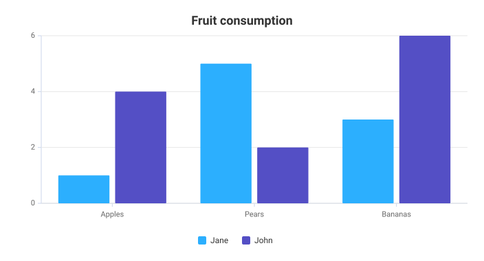

# FacetViz

FacetViz is a modular, dependency-free TypeScript and SVG visualization library
with a declarative configuration API.

**[Documentation](https://facetviz.github.io/facetviz/)** ·
**[Feature guide](https://facetviz.github.io/facetviz/features.html)** ·
**[Examples](https://facetviz.github.io/facetviz/examples.html)** ·
**[Playground](https://facetviz.github.io/facetviz/playground.html)**

Visit the documentation website for supported charts, configuration options,
themes, examples, and guides.

## Installation

```bash
npm install facetviz
```

## Quick start

```ts
import { FacetViz } from 'facetviz';

new FacetViz('#chart', {
  chart: { type: 'column' },
  title: { text: 'Fruit consumption' },
  xAxis: { categories: ['Apples', 'Pears', 'Bananas'] },
  series: [
    { name: 'Jane', data: [1, 5, 3] },
    { name: 'John', data: [4, 2, 6] },
  ],
});
```




### Metric cards

`FacetCard` renders a dashboard measure with optional change analysis and any
FacetViz chart. When `previousValue` is supplied, the difference and percentage
change are derived automatically.

```ts
import { FacetCard } from 'facetviz';

new FacetCard('#revenue-card', {
  title: { text: 'Revenue', subtitle: 'Current month' },
  value: 1284000,
  format: '$,.1s',
  comparison: {
    previousValue: 1150000,
    display: 'both',
    label: 'vs last month',
  },
  chart: {
    chart: { type: 'sparkline' },
    series: [{ data: [82, 91, 88, 105, 116, 128] }],
  },
});
```

Use `favorableDirection: 'decrease'` for measures such as response time or
defect count. Set `layout: 'horizontal'` to place the chart beside the measure.
First-class analytical blocks include `progress`, `breakdown`, split
`comparison`, radial `goal`, `status`, `range`, `forecast`, min/max `context`,
and operational `summary` rows.


## Development

```bash
npm install
npm run build
npm test
npm run dev
```

## License

MIT
